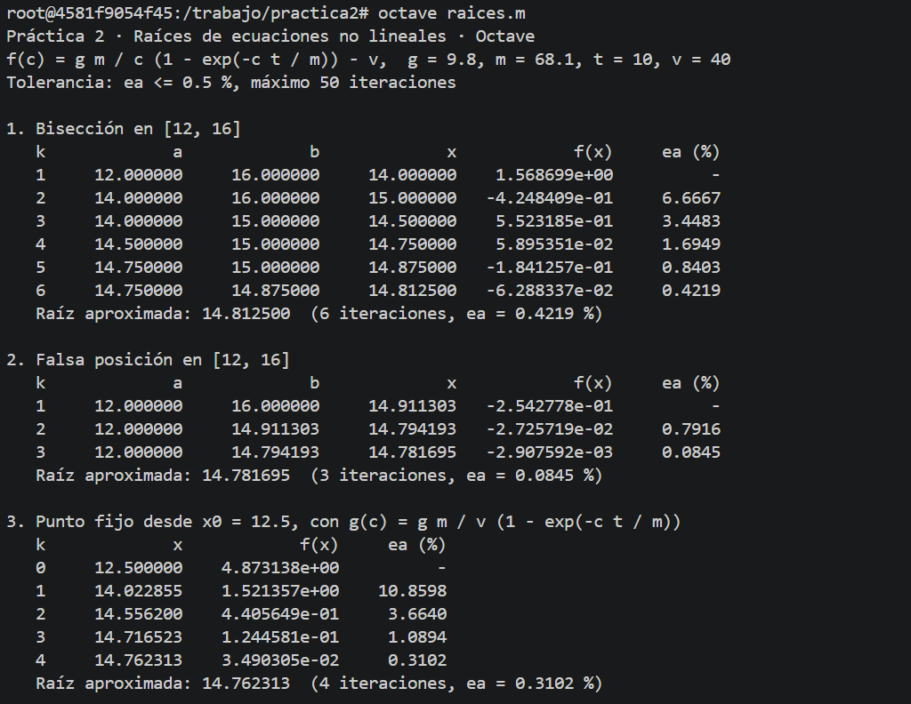
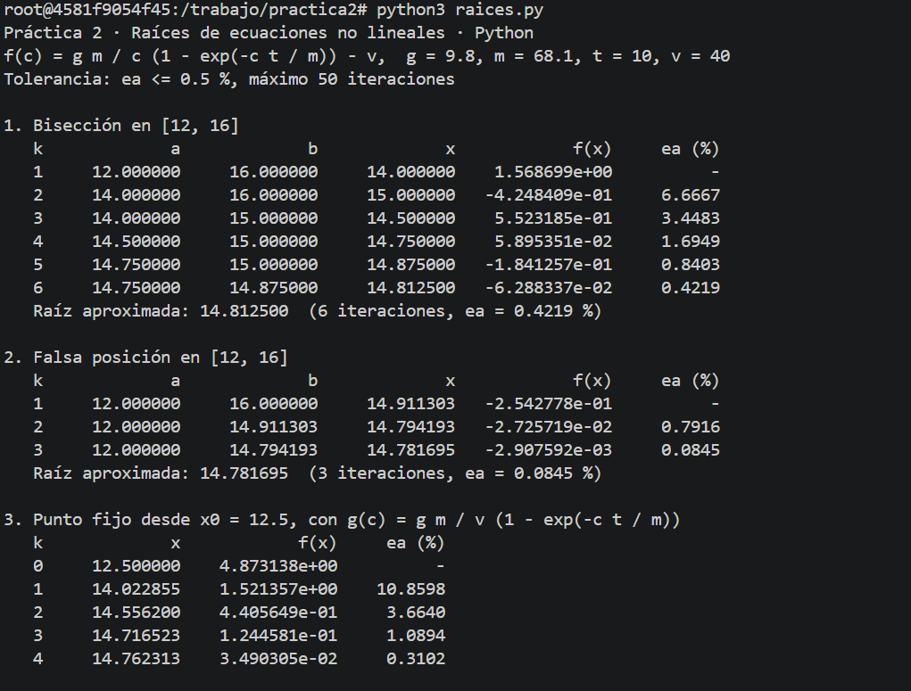
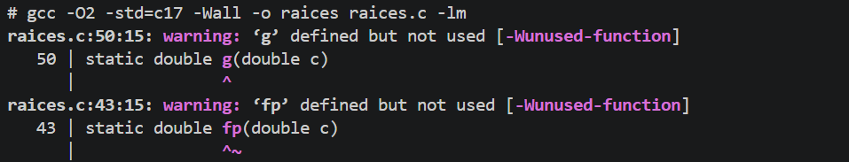
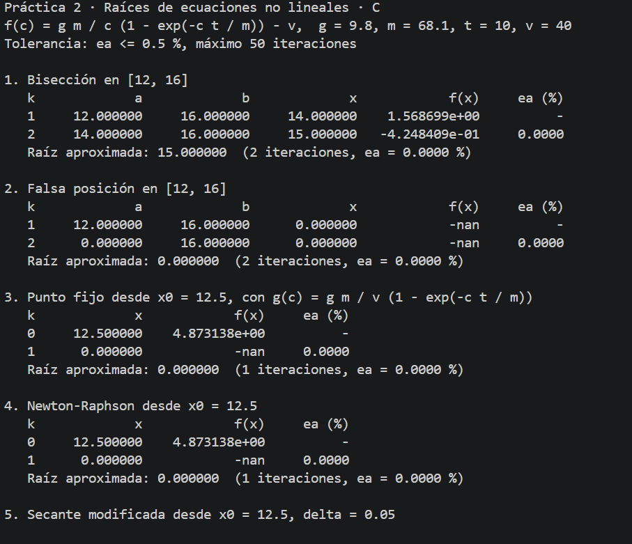
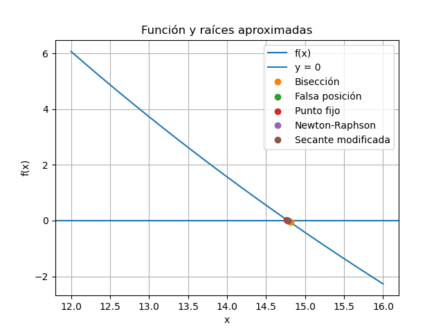
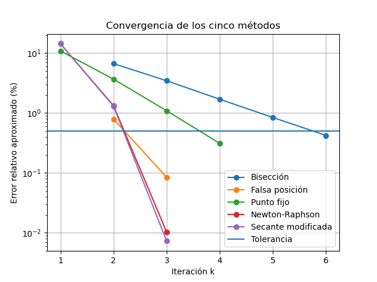
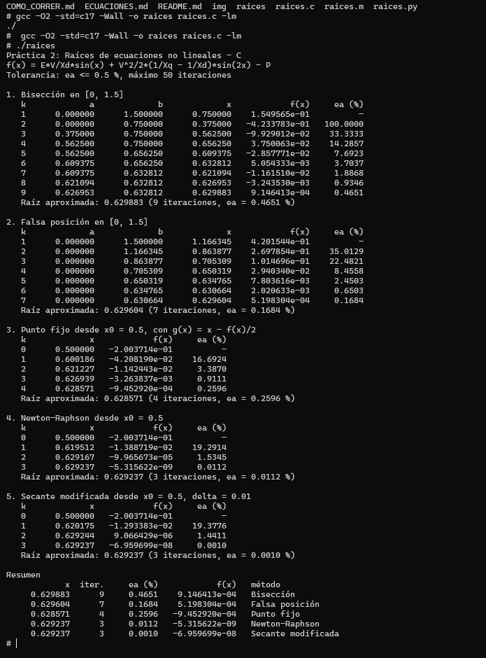
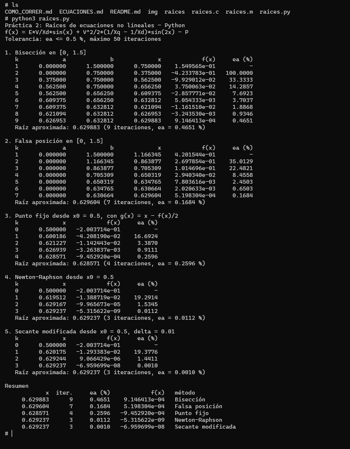

# Práctica 2 · Raíces de ecuaciones no lineales

**UEA 1151039 · Métodos Numéricos en Ingeniería · Trimestre 26-O · UAM Azcapotzalco**  
**Profesor:** M. en C. Gabriel Hurtado Avilés

| Dato | Información |
|---|---|
| Equipo | 1 |
| Integrantes (nombre, matrícula y licenciatura) | Donovan David Cruz Arreola, 2253078038, Ingeniería Eléctrica |
| Ecuación asignada | Número 11: Generador síncrono de polos salientes |
| Fecha | 10/10/2026 |

---

## 1. Octave y Python con nuestra ecuación

Se implementó la ecuación asignada en Octave y Python utilizando los cinco métodos numéricos de la unidad II. Se conservaron los mismos parámetros, el intervalo inicial, la aproximación inicial y la tolerancia para facilitar la comparación de resultados.

Las capturas siguientes corresponden a las ejecuciones de los programas y deberán agregarse después de ejecutarlos.





## 2. Las cinco líneas que completamos en `raices.c`

Las cinco líneas que se completaron corresponden al cálculo del error aproximado, la fórmula de falsa posición, la iteración de punto fijo, la fórmula de Newton-Raphson y la secante modificada.

```c
/* COMPLETAR 1: error aproximado */
return fabs((nuevo - anterior) / nuevo) * 100.0;

/* COMPLETAR 2: falsa posición */
x = (a * f(b) - b * f(a)) / (f(b) - f(a));

/* COMPLETAR 3: punto fijo */
x_nuevo = g(x);

/* COMPLETAR 4: Newton-Raphson */
x_nuevo = x - f(x) / fp(x);

/* COMPLETAR 5: secante modificada */
x_nuevo = x - f(x) * delta / (f(x + delta) - f(x));
```





**¿Coinciden las tablas de C con las de Octave y Python?**

Las tablas deben coincidir en sus resultados numéricos al utilizar las mismas fórmulas, parámetros y criterios de paro. Puede haber diferencias muy pequeñas en los últimos decimales debido al redondeo y a las operaciones de punto flotante. La coincidencia debe comprobarse con las salidas reales de los tres programas.

## 3. Las gráficas de Python

La gráfica de la función permite observar dónde cruza el eje horizontal la ecuación. La gráfica de convergencia permite comparar cómo cambia la aproximación de la raíz en cada iteración de los cinco métodos.





## 4. Nuestra ecuación

| Elemento | Expresión o valor |
|---|---|
| \(f(x)\) | \(1.5\sin(x)+\frac{1}{3}\sin(2x)-1.2\) |
| \(f'(x)\) | \(1.5\cos(x)+\frac{2}{3}\cos(2x)\) |
| \(g(x)\) | \(x-\frac{f(x)}{2}\) |
| Intervalo \([a,b]\) | \([0,1.5]\) rad |
| \(x_0\) y \(\delta\) | \(x_0=0.5\) rad, \(\delta=0.01\) |
| Tolerancia | \(\varepsilon_a\leq 0.5\%\) |
| Máximo de iteraciones | 50 |

La ecuación corresponde al ángulo de carga de un generador síncrono de polos salientes. Se utilizaron los parámetros \(E=1.5\), \(V=1\), \(X_d=1\), \(X_q=0.6\) y \(P=1.2\), expresados en por unidad.





### Tablas (salida de C)

Los siguientes valores corresponden a las iteraciones calculadas con las fórmulas implementadas. Se muestran redondeados a seis decimales para facilitar su presentación.

**Bisección**

| k | a | b | x | f(x) | εa (%) |
|---:|---:|---:|---:|---:|---:|
| 1 | 0.000000 | 1.500000 | 0.750000 | 0.154956 | — |
| 2 | 0.000000 | 0.750000 | 0.375000 | -0.423378 | 100.0000 |
| 3 | 0.375000 | 0.750000 | 0.562500 | -0.099290 | 33.3333 |
| 4 | 0.562500 | 0.750000 | 0.656250 | 0.037501 | 14.2857 |
| 5 | 0.562500 | 0.656250 | 0.609375 | -0.028578 | 7.6923 |
| 6 | 0.609375 | 0.656250 | 0.632813 | 0.005054 | 3.7037 |
| 7 | 0.609375 | 0.632813 | 0.621094 | -0.011615 | 1.8868 |
| 8 | 0.621094 | 0.632813 | 0.626953 | -0.003244 | 0.9346 |
| 9 | 0.626953 | 0.632813 | 0.629883 | 0.000915 | 0.4651 |

**Falsa posición**

| k | a | b | x | f(x) | εa (%) |
|---:|---:|---:|---:|---:|---:|
| 1 | 0.000000 | 1.500000 | 1.166345 | 0.420154 | — |
| 2 | 0.000000 | 1.166345 | 0.863877 | 0.269785 | 35.0129 |
| 3 | 0.000000 | 0.863877 | 0.705309 | 0.101470 | 22.4821 |
| 4 | 0.000000 | 0.705309 | 0.650319 | 0.029403 | 8.4558 |
| 5 | 0.000000 | 0.650319 | 0.634765 | 0.007804 | 2.4503 |
| 6 | 0.000000 | 0.634765 | 0.630664 | 0.002021 | 0.6503 |
| 7 | 0.000000 | 0.630664 | 0.629604 | 0.000520 | 0.1684 |

**Punto fijo**

| k | x | f(x) | εa (%) |
|---:|---:|---:|---:|
| 0 | 0.500000 | -0.200371 | — |
| 1 | 0.600186 | -0.042082 | 16.6924 |
| 2 | 0.621227 | -0.011424 | 3.3870 |
| 3 | 0.626939 | -0.003264 | 0.9111 |
| 4 | 0.628571 | -0.000945 | 0.2596 |

**Newton-Raphson**

| k | x | f(x) | εa (%) |
|---:|---:|---:|---:|
| 0 | 0.500000 | -0.200371 | — |
| 1 | 0.619512 | -0.013887 | 19.2914 |
| 2 | 0.629167 | -0.000100 | 1.5345 |
| 3 | 0.629237 | -0.000000 | 0.0112 |

**Secante modificada**

| k | x | f(x) | εa (%) |
|---:|---:|---:|---:|
| 0 | 0.500000 | -0.200371 | — |
| 1 | 0.620175 | -0.012934 | 19.3776 |
| 2 | 0.629244 | 0.000009 | 1.4411 |
| 3 | 0.629237 | -0.000000 | 0.0010 |

### Resumen

Para comparar los métodos se utiliza como referencia numérica de alta precisión una raíz aproximada de \(0.6292372743\) rad. El error verdadero se calcula mediante:

\[
E_v=\left|\frac{x_{\text{ref}}-x_{\text{aprox}}}{x_{\text{ref}}}\right|\times100
\]

| Método | Raíz aproximada | Iteraciones | εa (%) | f(raíz) | Error verdadero (%) |
|---|---:|---:|---:|---:|---:|
| Bisección | 0.629883 | 9 | 0.4651 | 9.1464e-04 | 0.102591 |
| Falsa posición | 0.629604 | 7 | 0.1684 | 5.1983e-04 | 0.058294 |
| Punto fijo | 0.628571 | 4 | 0.2596 | -9.4529e-04 | 0.105923 |
| Newton-Raphson | 0.629237 | 3 | 0.0112 | -5.3156e-09 | 0.000000596 |
| Secante modificada | 0.629237 | 3 | 0.0010 | -6.9597e-08 | 0.000007803 |

**Raíz de referencia (SciPy):** \(x\approx0.6292372743\) rad. Este valor debe confirmarse ejecutando un método de búsqueda de raíces de SciPy para registrar la referencia utilizada.

### Análisis

El método de Newton-Raphson y el de secante modificada necesitaron menos iteraciones, con tres cada uno, para alcanzar la tolerancia establecida. Ambos métodos utilizan información de la pendiente de la función, lo que permite acercarse rápidamente a la raíz cuando las aproximaciones iniciales son adecuadas.

La falsa posición necesitó siete iteraciones, mientras que bisección necesitó nueve. Esto se debe a que bisección divide el intervalo a la mitad en cada paso, mientras que falsa posición calcula el punto de corte de una recta que une los extremos del intervalo.

El método de punto fijo necesitó cuatro iteraciones para cumplir el criterio de paro. Su velocidad de convergencia depende del despeje elegido y de las propiedades de la función \(g(x)\).

Los cinco métodos no obtienen exactamente el mismo número porque utilizan procedimientos diferentes y se detienen cuando el error relativo aproximado es menor o igual a \(0.5\%\). Además, cada método puede alcanzar una aproximación distinta al momento de cumplir esa condición. En este caso, los cinco métodos alcanzaron la tolerancia dentro del límite de 50 iteraciones.

## 5. Cada integrante en su computadora

Cada integrante debe ejecutar `raices.c` con la ecuación del equipo en su propia computadora y subir la captura mediante un commit propio, siguiendo las indicaciones de `COMO_CORRER.md`, sección 7.

| Integrante | Usuario de GitHub | Captura |
|---|---|---|
| Donovan David Cruz Arreola | Pendiente de confirmar | `img/07-Donovan-Cruz.png` |


## Uso de inteligencia artificial

Se utilizó ChatGPT como apoyo para revisar y corregir la estructura de los programas en C y Python, completar las fórmulas de los métodos numéricos y organizar las tablas y el análisis para el README. Las ejecuciones, las capturas y la comparación final de los resultados deben verificarse con los programas utilizados en la práctica.

## Referencias

1. Chapra, S. C. y Canale, R. P. *Métodos numéricos para ingenieros*. McGraw-Hill.
2. Material de clase y láminas de la unidad II de Métodos Numéricos en Ingeniería, UAM Azcapotzalco.
